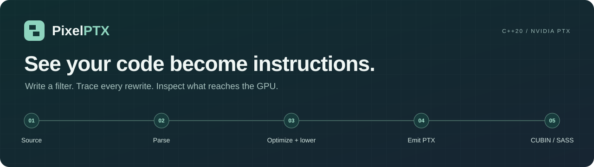
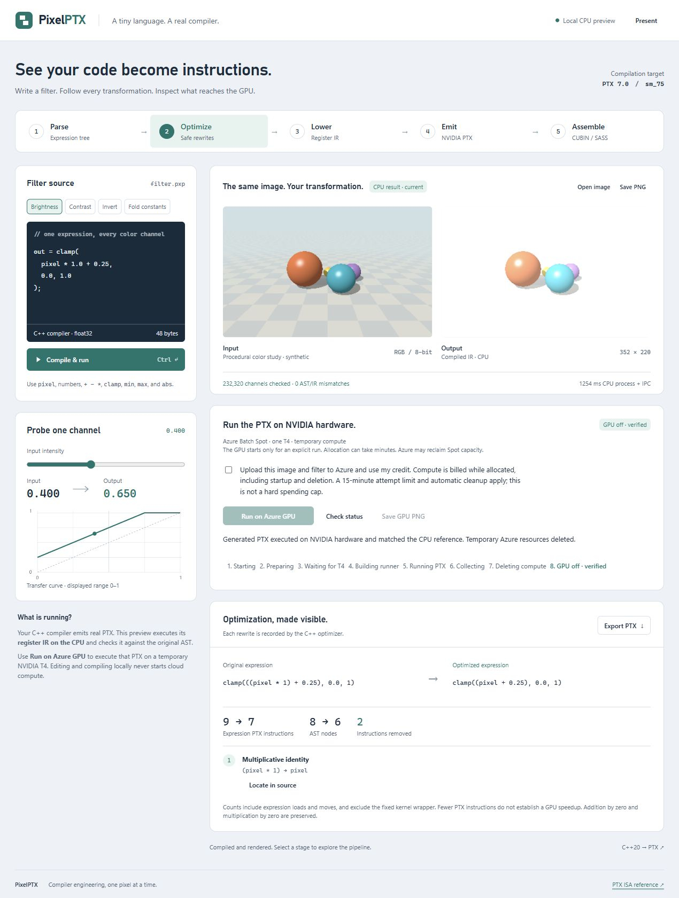
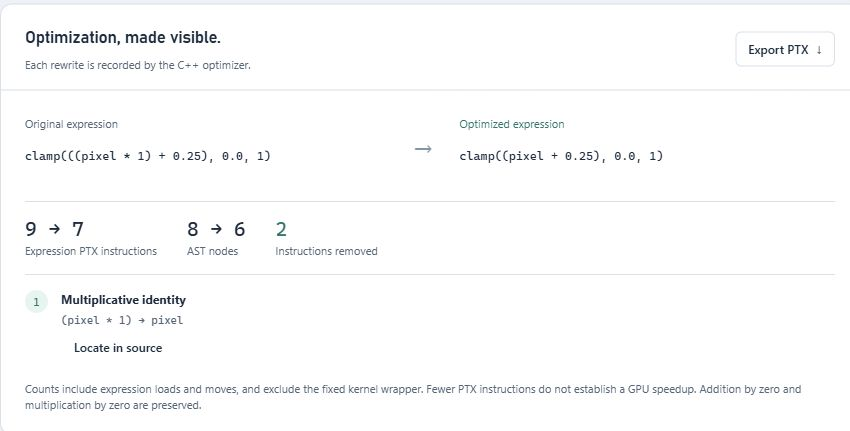
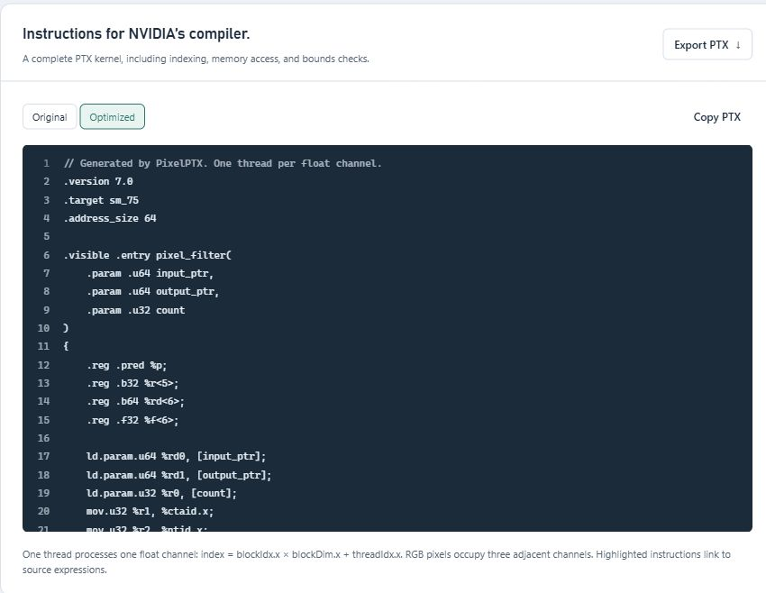
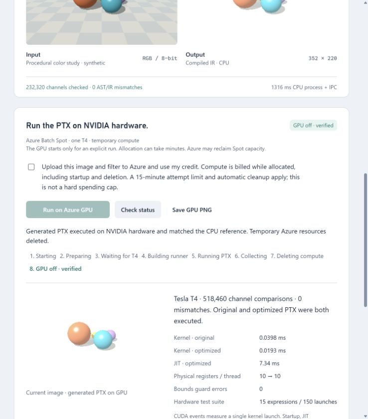
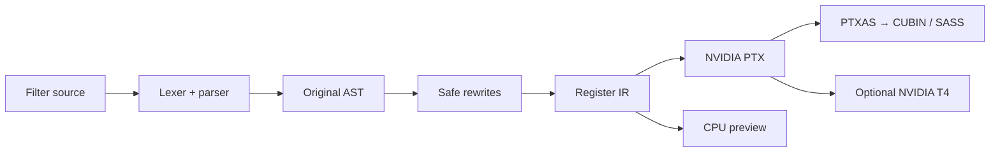

<div align="center">



# PixelPTX

**A tiny image-filter language. A real C++ compiler. A visual path to NVIDIA PTX.**

   

[Quick start](#quick-start) · [Visual tour](#visual-tour) · [How it works](#how-it-works) · [GPU execution](#run-on-azure-gpu) · [Architecture](docs/architecture.md)

</div>

Write an image filter, see its effect, and follow every step from expression tree to GPU instructions. PixelPTX brings parsing, optimization, register IR, and PTX generation into one local workbench, with optional execution on a real NVIDIA T4.



<p align="center"><sub>The brightness preset, running locally: 232,320 RGB channels checked against the original expression with zero AST/IR mismatches.</sub></p>

## From one expression to a kernel

```cpp
out = clamp(pixel * 1.0 + (0.1 + 0.15), 0.0, 1.0);
```

The C++ compiler folds `0.1 + 0.15`, removes multiplication by `1.0`, lowers the optimized tree into register IR, and emits a complete NVIDIA PTX kernel. Every rewrite is recorded and inspectable. The compiler is written from scratch, without LLVM or a JavaScript compilation layer.

| Explore | What you can see and do |
|:---|:---|
| **Image filters** | Try brightness, contrast, invert, or your own expression; open a PNG, JPEG, or WebP and export the result. |
| **Expression trees** | Compare original and optimized ASTs. Select a node to locate its source expression. |
| **Optimization** | Inspect recorded rewrites, exact float32 constants, and changes in expression instruction counts. |
| **Register IR** | Probe one color channel and step through register values on the CPU. |
| **NVIDIA output** | Inspect source-mapped PTX, assemble a CUBIN, and view SASS with optional NVIDIA tools. |
| **GPU execution** | Explicitly run original and optimized kernels on a temporary Azure T4 and compare device output with the AST reference. |

## Quick start

**Requirements:** Node.js **20.3+**, CMake **3.20+**, and a **C++20** compiler. No npm packages are required.

```sh
git clone https://github.com/Pikachu-5/pixelptx.git
cd pixelptx
npm run dev
```

Open **[127.0.0.1:4173](http://127.0.0.1:4173)**, choose a preset, and click **Compile & run**. Select a pipeline stage to explore its output. Use **Ctrl + Enter** to recompile after editing.

Subsequent launches can use `npm start`. On Windows, use `npm.cmd` if PowerShell blocks `npm.ps1`. This workspace was verified with MinGW GCC 13.2 and Ninja; Visual Studio users should open a Developer PowerShell with the C++ workload installed.

<details>
<summary><strong>Manual build, Visual Studio, and custom ports</strong></summary>

A clean build can be configured explicitly:

```powershell
cmake -S . -B build -G Ninja -DCMAKE_BUILD_TYPE=Release
cmake --build build
ctest --test-dir build --output-on-failure
node scripts/server.mjs
```

For Visual Studio's CMake generator, omit `-G Ninja` and build with `--config Release`. The server finds either build layout. Changing compilers requires a fresh build directory.

To use another port in PowerShell: `$env:PORT=4174; npm start`.

</details>

## Visual tour

### Watch the optimizer work

Compare the original expression with its optimized form, see which rewrite fired, and jump back to the relevant source. Instruction counts describe the generated expression; they are not GPU speedup measurements.



### Follow the output into PTX

Switch between original and optimized kernels, inspect the launch indexing and bounds checks, and select highlighted instructions to locate their source. Export the PTX for NVIDIA's tools or the optional GPU runner.



<details>
<summary><strong>See the verified NVIDIA T4 execution</strong></summary>

This capture is from the hardware run documented in the [verification report](docs/verification.md#nvidia-hardware-execution--october-21-2026). It shows the GPU output, comparison results, and confirmed cleanup of the temporary Azure resources.



CUDA event timings in this capture describe individual launches, not a controlled performance benchmark.

</details>

The default image is a deterministic ray-traced color study generated in the browser and labeled synthetic. You can also open your own image. The preview downsamples images for interaction, preserves alpha, and processes RGB as three independent float channels. Arithmetic operates on encoded channel values, not color-managed linear-light values.

## How it works



The C++ compiler owns parsing, optimization, lowering, evaluation, and PTX emission. A Node.js standard-library server connects it to the dependency-free browser workbench. See the [architecture notes](docs/architecture.md) for the kernel ABI, numeric semantics, and design tradeoffs.

### What works without an NVIDIA GPU?

The compiler, image preview, AST/IR visualization, correctness checks, PTX generation, and offline NVIDIA assembly/disassembly can run without an NVIDIA GPU. The preview executes **register IR on the CPU**, and compares each output against evaluation of the **original AST**.

**The IR interpreter does not interpret PTX.** Agreement between AST and IR does not prove that PTX code generation is correct. PTXAS acceptance validates assembly and target constraints, not GPU execution. Timings in the UI are local process time including IPC, never GPU timings.

The optional [Azure Batch Spot runner](docs/azure-gpu.md) loads the generated PTX with the CUDA Driver API, executes original and optimized kernels on a temporary NVIDIA T4, and compares device output against the original AST. The local preview remains CPU-only. Device linking, CUDA debugger integration, and rigorous performance benchmarking remain future work.

### Verified on hardware

The [October 21, 2026 verification run](docs/verification.md#nvidia-hardware-execution--october-21-2026) recorded:

| Check | Result |
|:---|:---|
| Hardware | NVIDIA Tesla T4 · compute capability 7.5 |
| GPU/CPU channel comparisons | **518,460** |
| Mismatches / output-guard errors | **0 / 0** |
| Additional differential launches | **150** across 15 expressions and 5 channel counts, using both PTX variants |
| Temporary Azure resources | Cleanup confirmed |

These results establish agreement for the tested cases. They do not establish correctness for every expression or a performance advantage.

## Run on Azure GPU

Install/sign in with Azure CLI, then configure the subscription locally:

```powershell
npm run azure:configure -- --subscription <subscription-id>
npm start
```

Compile a filter, acknowledge the upload/compute charge in the GPU panel, and click **Run on Azure GPU**. This uploads the displayed RGB image and generated PTX, requests **one Spot T4**, collects the GPU image and correctness report, and deletes the temporary resource group. It uses Azure credit; quota and capacity must be available. The GPU is billed while allocated, including startup, idle time, and deletion. Local editing and **Compile & run** never start cloud compute.

Allocation/build can take minutes. There is a 15-minute attempt deadline, an independent cloud scale-down rule, cancellation, and restart cleanup recovery. Scale-down and deletion are asynchronous, so the deadline is not a hard spending cap. Keep the server running until it confirms deletion; unresolved cleanup is visible and blocks another run. See [configuration, lifecycle, and recovery](docs/azure-gpu.md).

The CUDA runner can also be built separately on a machine with the CUDA Toolkit and an NVIDIA driver, without NVCC:

```powershell
cmake -S . -B build-cuda -DPIXELPTX_ENABLE_CUDA=ON
cmake --build build-cuda --config Release
```

## Optional NVIDIA tools

<details>
<summary><strong>Set up PTXAS, inspect CUBIN/SASS, and export kernels</strong></summary>

Use NVIDIA's official CUDA Toolkit, or the optional project-local tool setup script:

```powershell
powershell -ExecutionPolicy Bypass -File scripts/setup-cuda-tools.ps1
```

The script downloads official NVIDIA redistributables into ignored `.tools/`, verifies their SHA-256 hashes using NVIDIA's release manifest, and extracts the command-line compiler tools. It does not install a graphics driver or modify system PATH. NVIDIA's license files are retained. You are responsible for reviewing their terms before distributing NVIDIA tools; they are not part of this project's source.

The server searches `.tools/cuda/bin`, then `CUDA_PATH/bin`, then PATH, on each request. Click **Assemble → Check for tools** after installing.

Generated kernels declare PTX 7.0 and `sm_75`, matching the verified T4 execution target. This is an explicit target, not hardware auto-detection. The pinned local tools are CUDA 13.4.1 redistributables; other architectures require an appropriate toolchain and separate validation.

Manual inspection:

```powershell
build/pixelptx.exe --ptx examples/brightness.pxp > filter.ptx
ptxas -arch=sm_75 -v filter.ptx -o filter.cubin
nvdisasm filter.cubin
```

On Windows PowerShell 5, `>` may create UTF-16 text. Use the UI's PTX export, PowerShell 7, or `Set-Content -Encoding ascii` for PTX files.

</details>

## Language

Each expression transforms one scalar color channel. For example:

```cpp
// Brightness
out = clamp(pixel + 0.25, 0.0, 1.0);

// Contrast
out = clamp((pixel - 0.5) * 1.5 + 0.5, 0.0, 1.0);

// Invert
out = 1.0 - pixel;
```

Each example is a separate program. Supported operations are `+`, `-`, `*`, unary signs, `abs`, `min`, `max`, and `clamp`.

<details>
<summary><strong>Grammar, float32 semantics, and limits</strong></summary>

```ebnf
program = [ "out", "=" ], expression, [ ";" ];
expression = term, { ("+" | "-"), term };
term = unary, { "*", unary };
unary = ("+" | "-"), unary | primary;
primary = number | "pixel" | "(", expression, ")" | call;
call = "abs(", expression, ")"
     | ("min(" | "max("), expression, ",", expression, ")"
     | "clamp(", expression, ",", expression, ",", expression, ")";
```

Decimal literals and exponents are supported; literals round to finite float32. `//` line comments are accepted. Input is one scalar channel in [0,1]. Output can be outside that range; only display/export conversion clips it. `clamp(x,lo,hi)` is precisely `min(max(x,lo),hi)`, even when bounds are reversed. Nonfinite outputs are reported and displayed as black. PTX min/max use their non-NaN-propagating semantics.

Arithmetic uses explicit `.rn.f32` PTX instructions, no multiply-add contraction, no fast-math, and no reassociation. Safe rewrites currently include finite constant folding, multiplication by 1, and double negation. NaN payloads and signaling behavior are not part of the language's observable contract. Signed zero is preserved; unsafe `x + 0`, `x * 0`, and `x - x` rewrites are intentionally absent. See [architecture](docs/architecture.md) for limits and testing boundaries.

Limits: 8192 ASCII source bytes through the UI/API, 256 AST nodes, 48 levels of syntactic nesting, 8 MB request/image size, and 786432 channels per run. The image preview is at most 352×256. The CPU implementation favors readability over throughput.

</details>

## Verify

```powershell
npm test
npm run check
node scripts/tokens.mjs --check
```

Tests compare original AST, optimized AST, and IR results bit-for-bit, including signed zero and subnormal cases, plus NaN equivalence. Seeded generated expressions and parser fuzz inputs exercise optimizer and parser behavior. API tests cover source mapping, rendering, trace values, diagnostics, input limits, origin checks, and optional real PTXAS/SASS integration.

The C++ correctness suite covers **106,925 checks**, **134 filters**, and **1,500 parser fuzz inputs**. The Node test suite adds **20 HTTP and Azure lifecycle tests**. See the [verification report](docs/verification.md) for recorded results and testing boundaries.

## Project map

| Path | Responsibility |
|---|---|
| `include/pixelptx/compiler.hpp` | Compiler data model and public API |
| `src/compiler.cpp` | Lexer, parser, optimizer, IR, CPU evaluation, PTX generation |
| `src/main.cpp` | CLI and renderer protocol |
| `src/gpu_main.cpp` | CUDA Driver API runner and GPU differential checks |
| `scripts/server.mjs` | Loopback HTTP service and NVIDIA tool integration |
| `scripts/azure.mjs` | On-demand Azure Batch execution and cleanup |
| `web/` | Dependency-free visual workbench |
| `tests/` | C++ differential tests and HTTP integration tests |
| `docs/architecture.md` | Design decisions, ABI, numeric semantics, limitations |
| `docs/azure-gpu.md` | Azure setup, lifecycle, costs, and recovery |
| `docs/verification.md` | Automated checks and recorded hardware evidence |

Technical references: [NVIDIA PTX ISA](https://docs.nvidia.com/cuda/parallel-thread-execution/), [CUDA binary utilities](https://docs.nvidia.com/cuda/cuda-binary-utilities/), [CUDA compilation without a local GPU](https://forums.developer.nvidia.com/t/developing-code-in-cuda-in-a-virtual-gpu-or-on-hpc/291099).

---

<p align="center"><sub>Compiler engineering, one pixel at a time.</sub></p>
